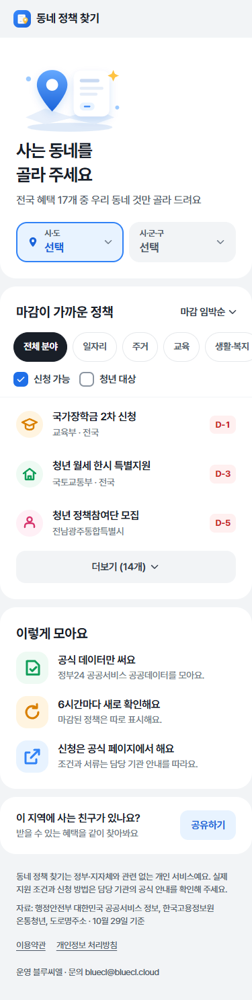
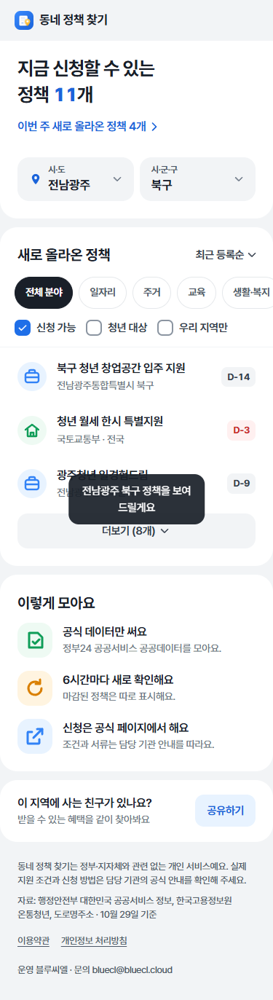
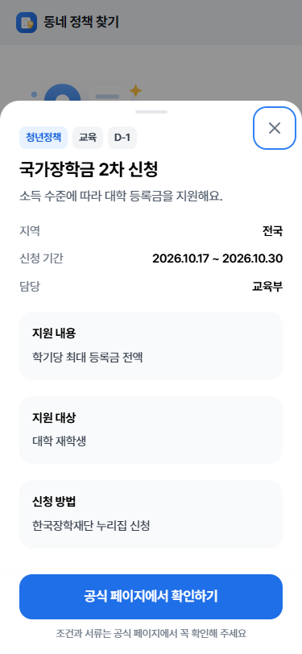

# policy · 동네 정책 찾기

고른 지역(시·도 → 시·군·구)에서 지금 신청할 수 있는 정부·지자체 혜택을 모아 보여 주는 앱인토스 미니앱이에요. 마감 임박순·최근 등록순·조회 많은순·이름순으로 정렬하고, 분야와 조건(신청 가능·청년 대상·우리 지역만)으로 거를 수 있어요.

지금 데이터는 정부24 공공서비스(혜택) API예요. "청년 대상"은 제목·대상·설명에 "청년"이 있는 혜택이에요(약 500건). 온통청년 청년정책 수집기는 만들어 두었지만 공공데이터포털 운영 승인이 나기 전까지는 키가 거부돼서 건너뛰어요. 승인되면 키만 넣으면 함께 모여요.

  

모든 기능은 무료예요. 인앱결제·광고는 없어요.

## 동작 방식

```text
systemd 타이머(6시간) → scripts/collect.ts
  ├ 온통청년 청년정책 API (YOUTH_API_KEY)        → server/sources/youth.ts
  └ 대한민국 공공서비스(혜택) API (DATA_GO_KR_API_KEY) → server/sources/gov24.ts
  → 지역 코드를 지금 행정구역으로 맞춤(shared/regions.ts) → SQLite
systemd 타이머(주 1회) → scripts/build-regions.ts → 도로명주소 API로 시·도/시·군·구 확인 → data/regions.json
미니앱 → GET /api/policies · /api/regions · /api/config
```

- **지역 목록**: 고정 목록 대신 도로명주소 API(JUSO_API_KEY)로 이름과 법정동코드를 하나씩 확인해요. 옛 이름으로 검색했는데 새 이름이 나오면 그 이름도 더해요. 2026-10-29 기준 시·도 16곳, 시·군·구 230곳이에요(일반구가 있는 시는 시 하나로 묶어요).
  - 2026-07-01 광주광역시·전라남도 → **전남광주통합특별시(12)**
  - 인천 중구·동구 → 제물포구·영종구, 서구 → 서해구·검단구
  - 화성시 일반구(만세·효행·병점·동탄)
- **옛 코드 처리**: 정책 데이터에 남은 옛 코드(29·46 → 12, 42 → 51, 45 → 52, 인천 28110 등)를 지금 지역으로 바꿔요.
- **화면 배치**: `tests/browser/audit.spec.ts`가 기준을 재요. 기준은 접힘선(375×812에서 동네 선택과 첫 정책이 보임), 글자 대비 4.5:1, 터치 높이 44px, 가로 넘침 없음, 조건 칩 한 줄이에요. 정렬·조건이 목록 카드 안에 있는지와 상세의 "공식 페이지" 버튼이 화면 안에 보이는지도 확인해요.
  - 첫 화면(고르기 전): 그림 → "사는 동네를 골라 주세요" → 전국 혜택 수 → **시·도 / 시·군·구 선택 칸**. 입력창은 없고 선택만 해요.
  - 고른 뒤: 신청 가능 개수 → "이번 주 새로 올라온 정책 N개 ›"(누르면 최근 등록순) → 같은 자리의 선택 칸. 장식 그림은 빼서 목록이 먼저 보여요.
  - 목록 카드: 제목·정렬 → 분야 칩 → 조건(신청 가능·청년 대상·우리 지역만) → 정책 3개 → 더보기.
  - 시·도를 고르면 바로 시·군·구 목록으로 넘어가요. 시·군·구 칸은 그 시·도 목록을 바로 열어요. 세종은 시·군·구 칸이 꺼져요.
  - 고른 동네는 기기에만 저장하고 서버로 보내지 않아요.
- **신청 상태**: 온통청년은 신청기간 코드(0057001 특정기간·0057002 상시·0057003 마감)를 먼저 보고, 없으면 날짜로 판단해요. 정부 혜택은 `신청기한` 문장에서 날짜와 "상시"를 읽어요.
- **키 처리**: 키가 없거나 거부되면 그 출처만 건너뛰고 저장된 목록은 그대로 둬요(타이머 실패로 쌓지 않아요). 상태는 `/api/policies`의 `sources`에 `ok / no-key / invalid-key / error`로 나와요.
- **목록 제목**: 같은 이름의 정책(여러 구의 "청년 월세 지원" 등)은 지역이나 기관 이름을 붙여 줄마다 달라요. 첫 화면 목록은 3개만 보이고 나머지는 더보기예요.

## 새 정책 알림 (만들어 두고 꺼 둠)

코드와 테스트는 들어 있지만 출시 앱에서는 보이지 않아요. 서버 `NOTIFY_ENABLED=false`이면 알림 API(POST/PUT/DELETE)가 열리지 않고 `/api/config`가 `notify:false`를 돌려줘서 앱이 버튼을 숨겨요.

- 흐름: 아래 고정 버튼 → 설정 창(고른 지역 확인) → `Notification.requestAgreement(policy-new)` → `User.createAnonymousKeyAuthCode` → 서버 교환 → 지역 저장
- 발송: 6시간 수집에서 **고른 지역에 새로 생긴 지역 정책**이 있으면 사람마다 하루 한 번까지 보내요. 전국 정책과 첫 수집은 알림에서 빼요. 50명 미만이거나 KST 21~08시는 한 건씩, 그 외는 대량 발송이에요.
- 개발 화면(`npm run dev`)에서는 알림이 켜져 있어요. `?notify=0`을 붙이면 출시 화면과 같아요.

켜는 순서:
1. 콘솔 › 푸시알림에서 기능성 캠페인 `policy-new`를 만들고, 알림동의문을 연결해 검수 승인을 받아요. 제목 예: `새 정책 등록`. 본문에 `{region}`, `{count}`, `{title}` 변수를 쓸 수 있어요.
2. 콘솔 › mTLS 인증서를 발급받아 서버 `certs/`(600)에 두고 `.env`의 `TOSS_MTLS_CERT`·`TOSS_MTLS_KEY`에 경로를 넣어요. 만료일은 이 README에 적어요.
3. `send-test-message`로 `policy-new` 성공을 먼저 확인해요.
4. bluecl.cloud는 Cloudflare 규칙 `BlueCL - restrict methods and private paths`와 nginx 서버 블록이 GET 외 요청을 막아요. **두 곳 모두** `/policy/api/`에 POST·PUT·DELETE 예외를 넣고, `deploy/policy.nginx.conf`의 `limit_except`에도 더해요.
5. 서버 `.env`: `NOTIFY_ENABLED=true`, `TOSS_NEW_TEMPLATE=policy-new`. 앱 `.env.production`: `VITE_TOSS_NEW_TEMPLATE=policy-new`. 그다음 서버 릴리스와 앱 배포를 해요.

캠페인은 승인 뒤 수정할 수 없어서, 바꿀 때는 `policy-new-2`처럼 새 코드로 만들어요.

## 로컬 실행

```powershell
npm ci
# 키는 backend/.env(또는 .env)에: YOUTH_API_KEY, JUSO_API_KEY, DATA_GO_KR_API_KEY
$env:POLICY_SEED_DEMO='true'; $env:TOSS_MOCK='true'; npm run dev   # 예시 정책으로 화면 확인
npm run collect     # 실제 API로 한 번 수집
npm run regions     # 지역 목록 다시 확인(shared/regions.json)
```

[localhost:5175](http://localhost:5175)에서 확인해요. 동 이름 검색은 `JUSO_API_KEY`가 있어야 해요.

## 검증

```powershell
npm test            # 지역·정렬·출처 변환·API·수집·알림 단위 테스트 28개
npm run test:e2e    # Edge 375·768·1440px 흐름 14개 (스크린샷 docs/screenshots 갱신)
npx playwright test --project=audit   # 배치 자동 점검 3개(어긋난 곳을 목록으로 보여 줘요)
npm run build       # 출시용: 설정 검사 → 콘솔 스크린샷 3장 → 타입 검사 → 번들 → policy.ait
npx ait deploy -m "<대표 커밋 메시지>"
```

`npm run build`는 `.env.production`의 `VITE_API_BASE_URL`(HTTPS)이 있어야 해요. 콘솔 스크린샷은 빌드 때마다 `docs/store/screenshot-1~3.png`(636×1048)로 덮어써요.

## 배포 (BlueCL)

현재 서버 릴리스 `policy-20261029012806`(2026-10-29 설치), 앱 번들 deploymentId `01a18546-0fd3-785e-add3-f15cbdc0e3a4`. 정부 혜택 9,933건 수집 중(온통청년은 운영 승인 대기).

`/home/solty/dev/policy/{releases,current,node,data,.env}`, API 포트 `18826`, 공개 경로 `https://bluecl.cloud/policy/api/`. Node는 gongmodu와 같은 `node` 링크(v24)를 써요.

업데이트: `server shared scripts tests deploy package*.json tsconfig.json`을 `releases/<rel>.tar.gz`로 올린 뒤 `bash current/deploy/release.sh <rel>`(처음엔 압축을 푼 폴더의 release.sh). 의존성 설치 → 서버 테스트 → `current` 교체 → `policy.service`만 재시작 → 상태 확인을 하고, 실패하면 이전 릴리스로 되돌려요.

최초 설치:

```sh
cp deploy/policy.service deploy/policy-collect.* deploy/policy-regions.* ~/.config/systemd/user/
systemctl --user daemon-reload
systemctl --user enable --now policy.service policy-collect.timer policy-regions.timer
sudo bash /home/solty/dev/policy/current/deploy/install-proxy.sh   # 한 번만: 백업 → include → nginx -t(실패 시 복구) → reload
```

서버 `.env`: `NODE_ENV=production`, `PORT=18826`, `POLICY_DB_PATH=/home/solty/dev/policy/data/policy.sqlite`, `REGIONS_PATH`·`REGIONS_OUT=/home/solty/dev/policy/data/regions.json`, 키 3개, `NOTIFY_ENABLED=false`. mTLS 인증서는 아직 없어요(알림을 켤 때 발급).

운영 확인:

```sh
systemctl --user list-timers 'policy-*'
journalctl --user -u policy-collect.service -n 20 --no-pager
curl -s http://127.0.0.1:18826/api/policies?limit=1 | head -c 400
```

## 구조

```text
shared/regions.json  최신 시·도/시·군·구(도로명주소 API로 확인)
shared/regions.ts    옛 코드·이름 바꾸기, 주소 → 지역
shared/policy.ts     정책 모델, 신청 상태, 정렬·필터
server/sources/      온통청년 · 공공서비스(혜택) 수집기
server/collector.ts  1회 수집·저장·새 정책 알림
server/app.ts        공개 API(GET), 알림 API(켤 때만)
server/juso.ts       도로명주소 검색
src/                 React 화면, 토스 SDK 연동, SVG 그림
scripts/             collect · regions · logo · 출시 검사
deploy/              systemd · nginx · release.sh
```

## 유의 사항

- 정부·지자체·토스와 관련 없는 개인 서비스예요. 앱 하단과 약관에 표시돼요.
- 데이터 출처: 한국고용정보원 온통청년, 행정안전부 대한민국 공공서비스 정보·도로명주소. 화면 하단에 출처와 기준일을 보여 줘요. 비공식 스크래핑(예: 온통청년 홈페이지 내부 순위 주소)은 쓰지 않아요.
- 정부 혜택은 `소관기관유형`·`소관기관명`으로 지역을 정해요. 중앙행정기관·공공기관은 전국, 광역시도는 시·도 전체, 시군구는 그 시·군·구예요. 이름에 지역이 없는 지자체 출연기관("(재)부천산업진흥원")은 같은 `소관기관코드`를 쓰는 지자체에서 지역을 배워요. 그래도 못 찾으면 잘못된 지역에 보이지 않게 목록에서 빼요(전체 10,942건 중 법인 대상 등 약 1,000건 제외). 신청기한은 `신청기한유형`(상시신청)과 문장 속 날짜(`20250901~20251001`, `2026. 3. 23. ~ 12. 11.` 등)를 읽어요.
- 실기기 토스 앱에서 알림 동의·메시지 수신은 콘솔 설정 뒤 직접 확인해야 해요.
